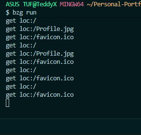
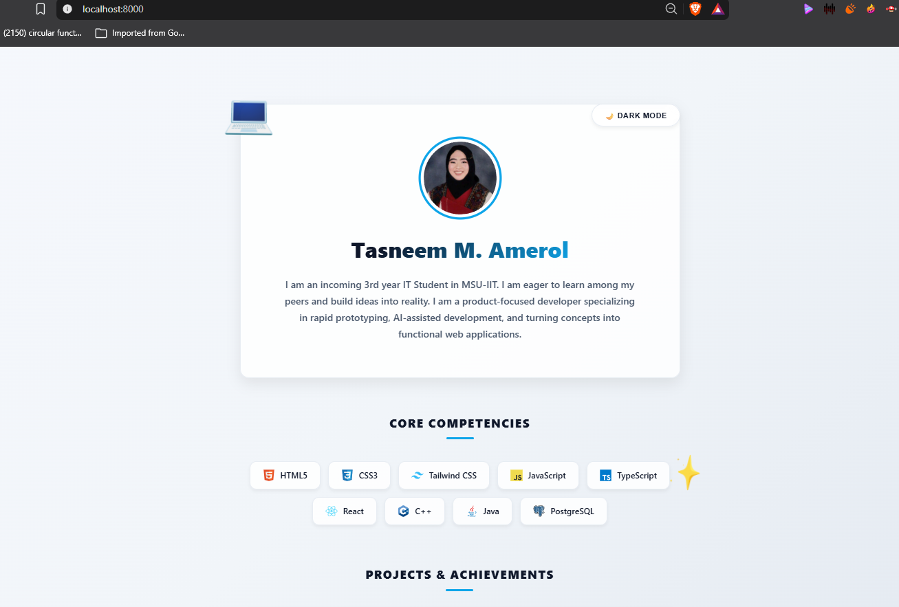

# Personal Portfolio Landing Page

## Project Description
A personal portfolio landing page constructed and served using the Bonezegei Scripting Language (BSL v1.3.3) HTTP Web Server framework. It features dynamic dark/light mode functionality, personal skill badges, project highlights, and contact links.

## Tech Stack
* **Language:** Bonezegei Scripting Language (BSL v1.3.3)
* **Frontend:** HTML5, CSS3, JavaScript
* **Version Control:** Git & GitHub

## Setup & Execution Steps
1. Clone the repository
2. Install dependencies: `bzg install`
3. Launch the web server: `bzg run`
4. Access at `http://localhost:8000`

## Execution Verification

### Terminal Verification

### Browser Verification
